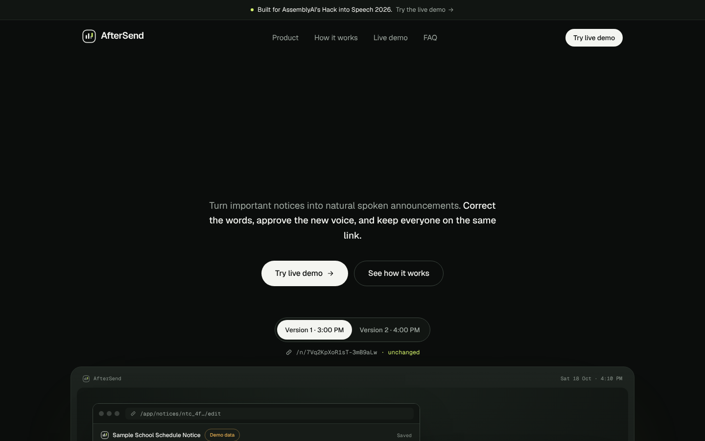
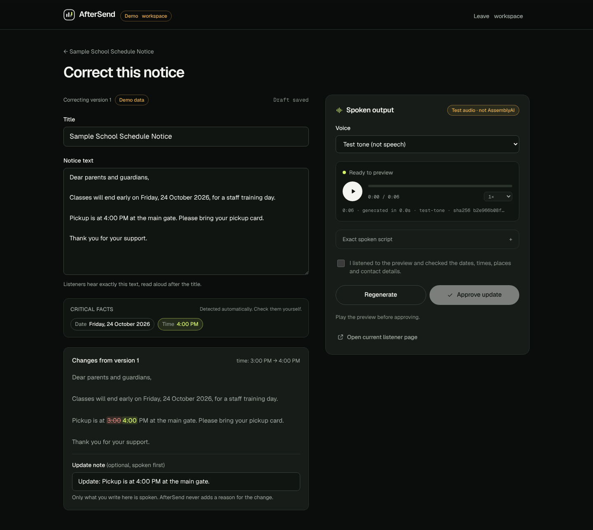
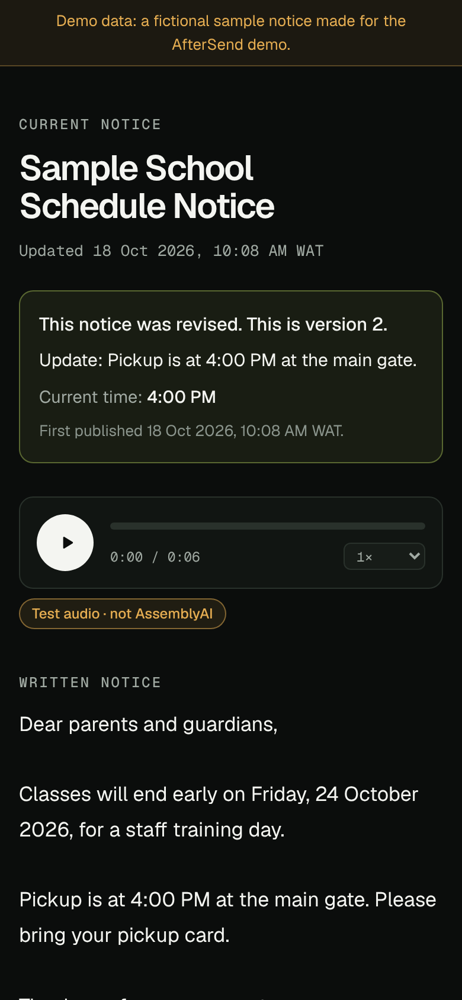
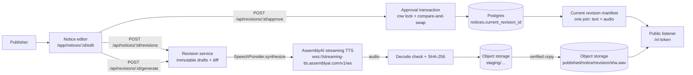

# AfterSend

**A spoken notice you can correct after the link is shared.**

AfterSend turns a school notice into a spoken announcement behind one stable link. When a detail changes, for example the pickup time, the publisher edits the text, listens to newly generated audio, and approves it. The link families already have then plays the corrected notice and shows the corrected text.



> **Status, 18 Oct 2026.** The product, the revision engine and the tests are built and pass locally. **Sponsor speech is not connected yet.** The AssemblyAI TTS adapter has no API key, and the hackathon endpoint's message protocol has not been published. Until both are in place, the deployed app refuses to generate audio rather than fake it. See [Known limitations](#known-limitations) and [`docs/ASSEMBLYAI_INTEGRATION.md`](docs/ASSEMBLYAI_INTEGRATION.md).

| | |
|---|---|
| Live app | Not deployed yet (needs hosting credentials and approval, see [Deployment](#deployment)) |
| Demo video | Not recorded yet. Script and shot list: [`docs/DEMO_SCRIPT.md`](docs/DEMO_SCRIPT.md) |
| Product spec | [`docs/PRD.md`](docs/PRD.md) |
| Measured results | [`RESULTS.md`](RESULTS.md) |

---

## Problem

A school office sends a notice to parents. Then a detail changes, or a wrong message starts circulating. The office can issue a correction, but forwarded screenshots and voice notes stay in group chats. A recording already on someone's phone can't be edited.

## Real-world context

On 14 May 2026, Lagos State's Office of Education Quality Assurance publicly told schools to disregard a circulating message claiming students would be dismissed early the next day ([source](https://oeqalagos.com/urgent-notice-disregard-circulating-message-on-school-dismissal/)). This shows that authoritative corrections matter. It does **not** show that audio would have prevented that incident, and AfterSend is not affiliated with OEQA.

## Solution

AfterSend is the place you send people to, not the messaging channel. The publisher shares one link. It always resolves to the newest **human-approved** version: its text and its own immutable audio file, published together.

## Core workflow

1. **Write.** Paste the exact notice. Dates, times and phone numbers are detected, and ambiguous numeric dates such as `05/06/26` block audio generation.
2. **Approve.** Generate the spoken preview, play it, confirm the critical facts, and approve. The stable link `/n/{token}` goes live.
3. **Correct.** Edit the notice and review a word-level diff (`3:00 PM` → `4:00 PM`). Optionally accept a suggested update note quoted from your own text. Generate new audio, listen, and approve. The same link now serves version 2.



## Why AssemblyAI

The spoken announcement is the product's output, and the hackathon's sponsor speech API is meant to produce it. The sponsor call sits behind a typed `SpeechProvider` interface in a server-only adapter ([`src/lib/speech/assemblyai.ts`](src/lib/speech/assemblyai.ts)) that targets the event endpoint `wss://streaming-tts.assemblyai.com/v1/ws`. Facts verified so far are recorded in [`src/lib/speech/assemblyai-protocol.ts`](src/lib/speech/assemblyai-protocol.ts): the endpoint is live, and it rejects unauthenticated sockets with a documented error frame ([evidence](evidence/tts-probe-unauthenticated-2026-10-18.json)). Nothing beyond that has been guessed.

## Features

- Stable, unguessable listener link (128-bit token). It stays byte-for-byte identical across versions, and end-to-end tests check this.
- Immutable revisions. Each approved version keeps its exact text, speech script, voice/model ids, audio digest (SHA-256) and timestamps.
- Atomic promotion. A row lock plus compare-and-swap on `current_revision_id` means a stale draft or a competing approval fails with a conflict instead of overwriting.
- Failure safety. Timeouts, provider errors, malformed audio or a text edit during synthesis never change what listeners get.
- Idempotent synthesis. A repeated or concurrent "Generate" for the same text, voice and model makes one provider call.
- Human approval is enforced on the server (`confirmedCriticalFacts`, preview ready) and in the UI (preview must be played first).
- Listener page: no sign-in, no autoplay, full text always shown, update banner and timestamp in the notice's time zone, live "newer version available" prompt, `noindex`.
- Withdrawal shows an explicit "withdrawn" page and stops serving audio.
- Dark, typography-led UI with GSAP and Motion animation, a reduced-motion mode, and full content without JavaScript.



*Screenshots come from a local production build using the **test-tone provider**. The audio there is a labelled tone, not speech, and the UI marks it "Test audio · not AssemblyAI".*

## Architecture



| Layer | Implementation |
|---|---|
| Web | Next.js 16 (App Router), React 19, TypeScript, Tailwind CSS 4 |
| Motion | GSAP 3 + ScrollTrigger (landing page, lazy-loaded), Motion for React (component transitions) |
| Data | PostgreSQL via Drizzle ORM. Locally and in tests, embedded Postgres (PGlite) |
| Storage | `ObjectStore` with local-disk and S3-compatible drivers, immutable revision paths, key allow-list |
| Auth | Workspace sessions: random 256-bit token in an httpOnly SameSite=Lax cookie, only its hash stored. Ownership is checked on every read and mutation |
| Speech | `SpeechProvider` interface. AssemblyAI adapter (server-only), plus a test-only tone provider for automated tests |
| Tests | Vitest (unit + integration on real Postgres semantics), Playwright (production build, desktop + mobile) |

### Project structure

```text
src/
  app/
    page.tsx                         landing
    demo/page.tsx                    judge demo entry
    app/…                            publisher workspace, new/detail/edit
    n/[publicToken]/page.tsx         public listener
    api/…                            REST API (see below)
  components/                        UI (landing/, app/, listener/, audio-player, logo)
  lib/
    db/schema.ts, db/client.ts       schema + Postgres/PGlite client
    notices/revision-service.ts      create, synthesize, approve, withdraw
    notices/public-manifest.ts       single-revision manifest + audio resolution
    notices/facts.ts, normalize-speech.ts, diff.ts
    speech/provider.ts, assemblyai.ts, assemblyai-protocol.ts, test-provider.ts
    storage/audio.ts, audio/wav.ts, auth/, http/
drizzle/                             SQL migrations
scripts/                             migrate, tts-probe, tts-smoke
tests/unit, tests/integration, tests/e2e
evidence/                            probe log, Lighthouse reports
docs/                                PRD, integration notes, demo script, submission copy, ledger
```

### API

| Method | Path | Notes |
|---|---|---|
| POST | `/api/workspace` | Create a workspace or an isolated demo workspace (rate-limited per IP) |
| GET/POST | `/api/notices` | List / create draft (owner) |
| GET | `/api/notices/:id` | Owner detail with revisions, audio, attempts |
| POST | `/api/notices/:id/revisions` | Start a correction; returns diff and fact changes |
| PATCH/DELETE | `/api/revisions/:id` | Edit / discard draft (edits invalidate stale previews) |
| POST | `/api/revisions/:id/generate` | Synthesize (idempotent, rate-limited per user and IP) |
| GET | `/api/revisions/:id/status` | Status, attempts, preview URL |
| GET | `/api/revisions/:id/audio` | Owner-only preview audio (`no-store`, Range support) |
| POST | `/api/revisions/:id/approve` | Atomic promotion; requires `confirmedCriticalFacts: true` |
| POST | `/api/notices/:id/withdraw` | Withdraw |
| GET | `/api/public/:token/current` | Listener manifest (`no-store`) |
| GET | `/api/public/:token/audio/:revisionId/:sha.wav` | Current revision only, immutable cache |
| GET | `/api/health`, `/api/voices` | Health / configured voices |
| GET | `/api/cron/cleanup` | Deletes staging audio older than 24 h (Bearer `CRON_SECRET`) |

Errors always use `{ code, message, retryable, correlationId }`. Raw provider or database errors never reach the client.

## Installation and running locally

Requires Node 20.9+.

```bash
git clone https://github.com/TheWeirdDee/aftersend && cd aftersend
npm install
cp .env.example .env.local      # then edit
npm run dev                     # http://localhost:3000
```

Without `DATABASE_URL`, the app uses embedded Postgres in `.data/pglite` and migrates it automatically. To click through the full flow without sponsor credentials, set `SPEECH_PROVIDER=test` and `AFTERSEND_ALLOW_TEST_PROVIDER=1`. Every clip is then a tone labelled "Test audio · not AssemblyAI".

### Environment

See [`.env.example`](.env.example). `ASSEMBLYAI_API_KEY` is read only on the server and is never sent to the browser.

### Database migrations

```bash
npm run db:generate            # after editing src/lib/db/schema.ts
DATABASE_URL=postgres://… npm run db:migrate
```

## Testing

```bash
npm run typecheck && npm run lint
npm test                       # Vitest: 51 unit + integration tests
npx next build && npm run test:e2e   # Playwright: 16 tests against a production build
```

Integration tests cover creation, synthesis, idempotency, concurrent approvals, stale drafts, failed and malformed synthesis, retries, edits during synthesis, authorization, withdrawal and staging cleanup. The e2e journeys cover first publication, correction at the same URL (old audio URL stops resolving, the new one serves `audio/wav`), failed synthesis, the mobile listener, cross-workspace access, CSRF, competing approvals, reduced motion, rendering without JavaScript, dead links and keyboard focus.

The automated suites use the test-tone provider. **They prove storage, revision and consistency behaviour, not speech quality or pronunciation.** Real-provider checks are in `npm run tts:smoke` (see below).

### Sponsor checks (once credentials exist)

```bash
npm run tts:probe              # records server frames to evidence/raw/ (no key printed)
npm run tts:smoke -- --runs 3  # original + corrected notice, saves WAVs and timings
```

## Deployment

Target: Vercel (web + API, `maxDuration` 60 s for synthesis), Supabase Postgres, and Supabase Storage through its S3 endpoint. Steps are in [`docs/DEPLOYMENT.md`](docs/DEPLOYMENT.md). **Nothing has been deployed.** It needs your hosting accounts and explicit approval.

## Security and privacy

- Provider keys are server-only. No key appears in client bundles or logs, and the probe never prints it.
- Every mutation checks session, ownership, same-origin `Origin`, JSON content type and a 32 KB body limit. Other users' notices return `404`.
- Rate limits are stored in Postgres: synthesis per user and IP, and workspace creation per IP.
- Input is stripped of tags and control characters, React escapes all output, and source links are restricted to http(s) and marked `nofollow`.
- Storage keys follow a strict allow-list pattern, so path traversal is rejected. Staging audio is owner-only and is deleted after 24 h.
- Listener pages are `noindex`, show no verification badges, and state that AfterSend does not verify the issuer.
- Security headers are set: `nosniff`, `DENY` framing, a strict referrer policy and a permissions policy.

## Verified results

Only measured numbers are listed. Details are in [`RESULTS.md`](RESULTS.md).

- 51/51 Vitest and 16/16 Playwright tests pass locally, on 18 Oct 2026.
- Lighthouse mobile on a local production build: landing page 90–94 performance, 100 accessibility, 100 best practices, 100 SEO; `/demo` 93–95 performance and 100 on the rest.
- No horizontal overflow on any page at 320, 375, 390, 430, 768, 1024, 1280, 1440 or 1920px.
- **AssemblyAI synthesis: not yet measured.** No authenticated request has been made.

## Known limitations

- **No real sponsor audio yet.** Two things block it: an `ASSEMBLYAI_API_KEY`, and the hackathon TTS message schema (text frame, voices, audio format, completion frame). Once those exist, filling in `assemblyai-protocol.ts` and running `npm run tts:smoke` is the remaining work.
- Workspaces are tied to one browser (cookie session). There are no email accounts yet.
- Synthesis runs inside the API request (bounded by the provider timeout and retries). Long notices may need a background worker once real latency is known.
- No PDF import, QR export, multiple-voice catalogue or analytics. These are P1/P2 in the PRD.
- The AssemblyAI Agent was used during early research and hit its free-tier limit without producing a working integration. No bonus eligibility is claimed.

## Hackathon submission

Built for AssemblyAI's *Hack into Speech 2026*. Not affiliated with or endorsed by AssemblyAI. Draft submission copy is in [`docs/SUBMISSION.md`](docs/SUBMISSION.md). **It has not been submitted.**
